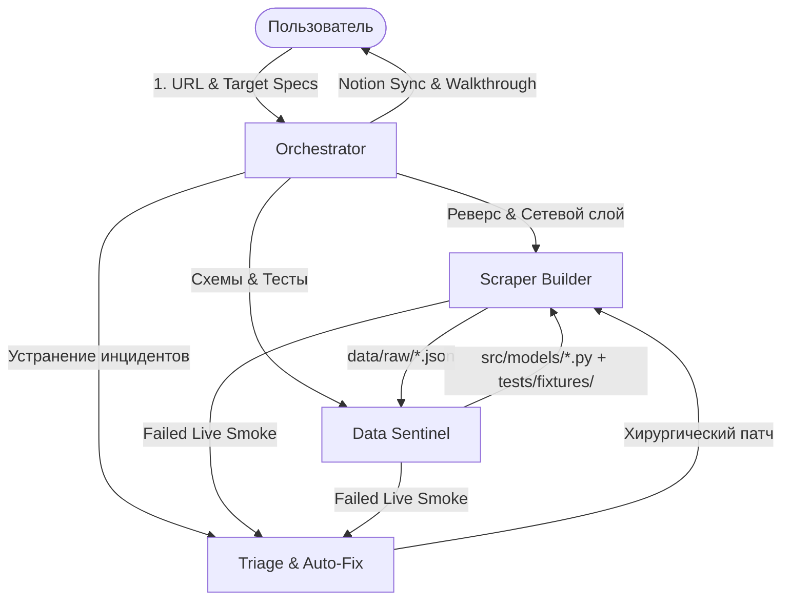

# Multi-Agent Architecture & Operating Protocols

Архитектура системы разработки и сопровождения веб-скрейперов на базе автономных субагентов.

---

## 1. Orchestrator (Manager)
- **Зона ответственности:** Координация воркфлоу, инициализация репозиториев (`uv venv`), запуск сквозных E2E-пайплайнов, синхронизация с Notion.
- **Взаимодействие с пользователем:** Получение исходных данных (URL/эндпоинты), согласование плана (`implementation_plan.md`) и демонстрация финальных результатов (`walkthrough.md`).
- **Инструменты:** Все доступные инструменты координации, MCP-интеграции (Notion, DevTools).

---

## 2. Scraper Builder (Инженер сбора)
- **Имя агента:** `scraper-builder`
- **Зона ответственности:** 
  - Разработка сетевого клиента [`src/core/client.py`](file:///d:/Programming/Projects/Portfolio/Scraping/asos-store/src/core/client.py) (`ResilientHttpClient` на базе `curl_cffi` с имперсонацией TLS Chrome/Safari).
  - Написание экстракторов [`src/extractors/`](file:///d:/Programming/Projects/Portfolio/Scraping/asos-store/src/extractors/) с пагинацией, обработкой заголовков и параметров.
  - Сохранение первого сырого ответа в `data/raw/` для передачи агенту Data Sentinel.
  - Создание live smoke-тестов [`tests/test_live.py`](file:///d:/Programming/Projects/Portfolio/Scraping/asos-store/tests/test_live.py).
- **Гардрейлы:**
  - Запрещено использовать `requests` или `BeautifulSoup` на ресурсах с WAF/защитой от ботов.
  - Соблюдение приоритета: Reverse-engineered API (`curl_cffi`) -> HTML Scraping (`curl_cffi`) -> Headless Browser (`Camoufox`).

---

## 3. Data Sentinel (Контролер качества данных)
- **Имя агента:** `data-sentinel`
- **Зона ответственности:**
  - Анализ сырых дампов ответов из `data/raw/`.
  - Генерация строгих моделей Pydantic v2 в [`src/models/`](file:///d:/Programming/Projects/Portfolio/Scraping/asos-store/src/models/).
  - Нормализация цен, расчет процента скидок, приведение ссылок к абсолютным (`https://`).
  - Создание локальных фикстур [`tests/fixtures/`](file:///d:/Programming/Projects/Portfolio/Scraping/asos-store/tests/fixtures/) и написание оффлайн юнит-тестов [`tests/test_unit.py`](file:///d:/Programming/Projects/Portfolio/Scraping/asos-store/tests/test_unit.py).
- **Гардрейлы:**
  - Запрещено модифицировать сетевой слой `src/core/` или логику парсинга `src/extractors/`.
  - Все юнит-тесты должны выполняться без сетевых обращений.

---

## 4. Triage & Auto-Fix (Инженер инцидентов)
- **Имя агента:** `triage-fix`
- **Зона ответственности:**
  - Анализ логов сбоев (`logs/`) и дампов упавших ответов (`failed_payload`).
  - Дифференциация инцидента:
    - *Сетевые сбои / Anti-bot / Store 400:* ротация заголовков, корректировка store/currency, TLS-имперсонации.
    - *Сдвиг верстки / Schema Drift:* обновление селекторов или JSON-ключей в экстракторе.
  - Верификация исправлений через `uv run pytest -m unit` и `uv run pytest -m live`.
- **Гардрейлы:**
  - Запрещено переписывать модуль целиком — только точечные хирургические исправления.
