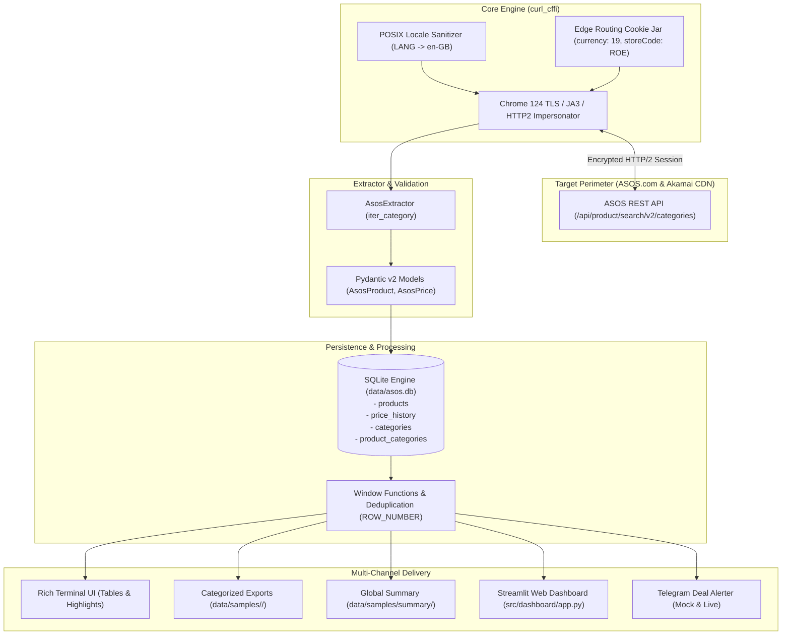

# 🛍 ASOS E-commerce Catalog & Price Monitor

[](https://www.python.org/)
[-brightgreen.svg)](https://github.com/yifeikong/curl_cffi)
[](https://docs.pydantic.dev/)
[-lightgrey.svg)](https://www.sqlite.org/)
[](https://streamlit.io/)
[](https://docs.pytest.org/)
[](LICENSE)

An enterprise-grade, resilient web scraping pipeline and price intelligence monitor for **ASOS** (global e-commerce fashion marketplace). The system reverse-engineers internal REST APIs, bypasses Akamai Edge CDN bot management via hardware-level TLS/JA3 impersonation, normalizes product feeds with Pydantic v2, tracks price dynamics in SQLite, and provides an interactive Streamlit dashboard alongside Telegram deal alerting.

---

## 📌 Executive Summary & Business Value

* **Competitive Price Intelligence:** Tracks real-time price drops, discount percentages (up to -76%), and markdown velocity across 10 major commercial fashion categories.
* **Arbitrage & Deal Scouting:** Automatically isolates high-margin clearance items and deals into category-specific datasets.
* **Zero-Block Uptime:** Full Akamai CDN bypass without heavy headless browsers (Puppeteer/Playwright), delivering 50x lower CPU/RAM consumption and high throughput.
* **Modular Multi-Channel Delivery:** Structured outputs for both technical ingestion (SQLite, CSV, JSON) and non-technical stakeholders (Streamlit Dashboard, Rich CLI, Telegram Alerts).

---

## 🏛 Architecture Overview



---

## ⚡ Key Engineering Features

1. **Akamai Edge Bypass & Store Routing:**
   * Uses `curl_cffi` to match Google Chrome 124 TLS cipher suites, extensions, and HTTP/2 settings byte-for-byte.
   * Auto-manages edge routing cookies (`storeCode=ROE`, `currency=19` for EUR, `browseCountry=BG`, `siteChromeVersion`), completely eliminating `400: No valid store was found` errors.
2. **Strict Data Contracts (Pydantic v2):**
   * Pre-validation URL normalizers (auto-converts protocol-relative URLs `//images...` to absolute `https://...`).
   * Handles edge cases such as discontinued products with null images and unannounced layout variations.
3. **Relational SQLite Persistence:**
   * Many-to-Many mapping (`product_categories`) allows products in overlapping categories without duplicating item cards or price snapshots.
   * Time-series price monitoring: records temporal snapshots in `price_history` to track discounts over time.
   * SQL Window functions (`ROW_NUMBER() OVER PARTITION BY product_id ORDER BY id DESC`) prevent duplicate records in deal feeds.
4. **Product Lifecycle & Delisting Management:**
   * Tracks `last_seen_at` timestamp and boolean `is_active` status for every product.
   * Running a complete category crawl (`--all`) automatically flags delisted and out-of-stock items (`is_active = 0`), keeping analytics and active deal feeds 100% synchronized with the live storefront while retaining historic price data.
5. **Interactive Streamlit Dashboard:**
   * Filter catalog by category, brand multiselect, maximum price, and minimum discount percentage.
   * Visual product cards with direct ASOS links.
   * Price distribution, category volume, and top-discounted brand analytics.
   * Toggle between active-only and full historic catalog views.
6. **Telegram Alerting Skeleton:**
   * Modular alerter (`TelegramAlerter`) with HTML formatting.
   * Runs in **Safe Mock / Simulation Mode** when no bot tokens are set, logging alerts to console without crashing.

---

## 📁 Project Structure

```plain text
asos-store/
├── pyproject.toml              # Dependencies and metadata (managed via uv)
├── .env.example                # Configuration template
├── README.md                   # Project showcase & documentation
├── SCRAPER_SPEC.md             # Resource & API passport
├── config/
│   ├── settings.py             # Pydantic BaseSettings with POSIX locale protection
│   └── categories.py           # Catalog registry (Trainers, Hoodies, T-Shirts, etc.)
├── data/
│   ├── asos.db                 # SQLite relational database
│   ├── raw/                    # Raw JSON sample responses
│   └── samples/                # Categorized CSV / JSON exports
│       ├── trainers/           # Category-specific deals & products
│       ├── hoodies/            # Category-specific deals & products
│       ├── t-shirts/
│       ├── ... (10 categories)
│       └── summary/            # Global cross-category summaries
├── src/
│   ├── alerts/
│   │   └── telegram.py         # Telegram bot notification pipeline
│   ├── core/
│   │   └── client.py           # ResilientHttpClient with Chrome TLS impersonation
│   ├── dashboard/
│   │   └── app.py              # Interactive Streamlit Web Application
│   ├── extractors/
│   │   ├── base.py             # Base extractor contract
│   │   └── asos.py             # ASOS REST API pagination and recovery extractor
│   ├── models/
│   │   └── product.py          # Pydantic v2 schemas (AsosProduct, AsosPrice)
│   ├── pipelines/
│   │   ├── db.py               # SQLite persistence, window queries & migrations
│   │   └── export.py           # Multi-directory CSV/JSON exporter
│   ├── utils/
│   │   └── logger.py           # Loguru rotation logger
│   └── main.py                 # Rich CLI runner & orchestrator
└── tests/
    ├── fixtures/               # Offline JSON mock fixtures
    ├── test_unit.py            # Unit tests (Models, DB, Exports, Alerts)
    └── test_live.py            # Smoke test against live ASOS endpoint
```

---

## 🚀 Quick Start & Installation

This project uses [`uv`](https://github.com/astral-sh/uv) for blazing-fast, isolated dependency management.

### 1. Clone & Set Up Environment
```bash
# Clone the repository
git clone https://github.com/your-username/asos-store.git
cd asos-store

# Create virtual environment and sync dependencies
uv sync
```

### 2. Configure Environment (Optional)
```bash
cp .env.example .env
```
*(You can leave `.env` empty or omit it; defaults provide full functionality in Mock mode).*

---

## 💻 CLI Usage Guide

Run the main scraper orchestrator via `uv run python -m src.main`:

### 🔹 Single Category Scrape (Default: Trainers - 5775)
```bash
# Collect 72 sneakers and display top deals table:
uv run python -m src.main --limit 72 --max-items 72
```

### 🔹 Scrape Any Category by ID
```bash
# Hoodies & Sweatshirts (ID: 5668):
uv run python -m src.main --category-id 5668 --limit 72 --max-items 144

# Jackets & Coats (ID: 3606):
uv run python -m src.main --category-id 3606 --limit 72 --max-items 72
```

### 🔹 Cross-Category Scraping (`--all-categories`)
```bash
# Scrape initial batches across all 10 registered categories:
uv run python -m src.main --all-categories --limit 72 --max-items 72

# Full catalog extraction of all 10 categories (~23,000 products):
uv run python -m src.main --all-categories --all
```

### 🔹 Trigger Telegram Deal Alerts
```bash
# Scrape hoodies and trigger deal notifications (runs in mock mode without credentials):
uv run python -m src.main -c 5668 --notify
```

### 🔹 CLI Parameters Reference
| Flag | Short | Default | Description |
|:---|:---:|:---:|:---|
| `--category-id` | `-c` | `5775` | ASOS Category ID to scrape |
| `--all-categories` | | `False` | Sequentially scrape all 10 registered categories |
| `--limit` | `-l` | `72` | Number of items per request page |
| `--max-items` | `-m` | `144` | Maximum items to collect per category |
| `--all` | | `False` | Ignore max-items and paginate to end of category |
| `--notify` | | `False` | Evaluate and dispatch Telegram deal notifications |
| `--db-per-category` | | `False` | Store data in isolated `data/categories/<slug>.db` |
| `--no-export` | | `False` | Skip writing CSV and JSON files to `data/samples/` |

---

## ⏰ Automated Scheduled Runs (GitHub Actions)

The repository includes a production-grade CI/CD automation workflow (`.github/workflows/scraper.yml`):
* **Daily Cron Schedule:** Runs automatically every day at `06:00 UTC` with a full catalog crawl across **ALL categories** (`--all-categories --all`) to refresh complete inventory (~25,000 items) and track price drops.
* **Manual Dispatch:** Trigger custom crawls on-demand from the GitHub Actions tab (defaults to all categories, with option to select specific categories like `shoes`, `trainers`, etc.).
* **Flat Data Auto-Commit:** Uses `git-auto-commit-action` to commit updated `data/asos.db` and `data/samples/` back to the repository.
* **Database Artifacts:** Uploads a 30-day downloadable backup of `data/asos.db` after every execution.

> **Setup Checklist in GitHub Repository:**
> 1. Navigate to **Settings** ➔ **Actions** ➔ **General** ➔ **Workflow permissions** and choose **Read and write permissions**.
> 2. *(Optional for live alerts)* Navigate to **Settings** ➔ **Secrets and variables** ➔ **Actions** and add `TELEGRAM_BOT_TOKEN` and `TELEGRAM_CHAT_ID`.

## 📊 Streamlit Interactive Dashboard

Launch the interactive web UI to explore products, inspect markdown deals, and analyze pricing trends:

```bash
uv run streamlit run src/dashboard/app.py
```

### Dashboard Features:
* **Interactive Filters:** Filter by category, brand multiselect, minimum discount %, and price slider.
* **Deal Cards Showcase:** Responsive image grid with direct links to ASOS product pages.
* **Market Analytics:** Brand comparison charts and category volume breakdowns.
* **Data Export:** Instant one-click CSV and JSON download of filtered data.
* **Alert Testing:** Interactive trigger to preview and simulate Telegram notification templates.

---

## 🏷 Supported Categories Registry

The system includes pre-configured metadata and route mappings in `config/categories.py`:

| Category ID | English Title | Slug | Est. Catalog Size |
|:---:|:---|:---:|:---:|
| **4209** | Shoes, Boots & Trainers (Full Footwear) | `shoes` | ~2,300 items |
| **5775** | Trainers & Sneakers | `trainers` | ~1,250 items |
| **5668** | Hoodies & Sweatshirts | `hoodies` | ~2,000 items |
| **7616** | T-Shirts & Vests | `t-shirts` | ~7,100 items |
| **4208** | Jeans | `jeans` | ~1,550 items |
| **3606** | Jackets & Coats | `jackets` | ~1,900 items |
| **4910** | Trousers & Chinos | `trousers` | ~2,750 items |
| **3602** | Shirts | `shirts` | ~3,000 items |
| **7617** | Jumpers & Cardigans | `sweaters` | ~1,500 items |
| **5774** | Boots | `boots` | ~200 items |
| **4210** | Accessories | `accessories` | ~1,750 items |

---

## 🧪 Testing & Quality Assurance

The project includes offline unit tests, regression tests, and live smoke tests executed via `pytest`:

```bash
uv run pytest -v
```

### Test Coverage Highlights (13/13 PASS):
* `test_live_asos_catalog_fetch_limit_72_no_cookies`: Real HTTP GET test verifying 72 items returned per batch.
* `test_lifecycle_tracking_and_deactivation`: Validates `last_seen_at` updates, `is_active` flag transitions, and automatic deactivation of missing items.
* `test_language_sanitization`: Verifies system POSIX locales (e.g., `LANG=en_US.UTF-8`) are sanitized to ASOS IETF codes (`en-GB`).
* `test_null_image_url_handling`: Verifies discontinued/placeholder products parse safely.
* `test_database_category_relations`: Validates Many-to-Many SQLite schema and isolated deal queries.
* `test_category_and_global_exports`: Validates multi-directory CSV/JSON export accuracy.
* `test_telegram_alerter_mock_mode`: Validates notification formatting and credential-free fallback.

---

## ⚖️ Legal & Ethical Scraping Notice

This project was built for educational, portfolio, and research purposes.
* All requests respect web etiquette by enforcing polite jitter delays (`0.5s – 1.2s`) between page requests.
* Requests hit public catalog search endpoints and do not circumvent user logins, paywalls, or collect personal identifiable information (PII).
* When adapting for production, ensure compliance with ASOS Terms of Service and local data regulations.
